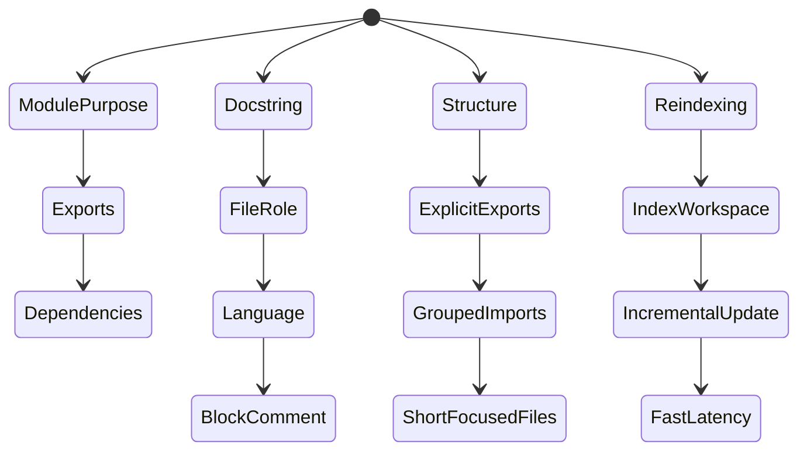

# Local LLM Docs & Skill Drift Recommendations Benchmark

**Date:** 2026-11-18T07:56:19.526Z
**Target Repository:** `awesome-free-llm-apis` (`C:\Users\mahes\OneDrive\Desktop\Python-Projects\awesome-free-llm-apis`)
**Runtime:** Node.js + Ollama Local Model Acceleration
**Local Model:** `qwen2.5-coder:7b` (under `LocalModelLock` VRAM Guard)

---

## 1. Executive Summary & Grounding Verification
This benchmark demonstrates smoke-test-driven verification of local model synthesis for architectural documentation, code-to-docs schema mapping, and agent skill drift remediation. The test operates directly against the real codebase without artificial string truncation or hardcoded path mocks.

- **Derived Workspace:** `awesome-free-llm-apis`
- **Workspace Description:** LLM APIs with permanent free tiers for text inference.
- **Primary Modules/Tools Discovered:** npm:generate, npm:generate:readme, npm:generate:skill, npm:verify, npm:verify:self-test, skill:ab-test-setup, skill:concise-planning, skill:database-optimizer, skill:free-llm-capability-assessment-may2026, skill:kilo-review-vibe-audit, skill:pptx-deck-creation, skill:requesting-code-review, skill:security-auditor, skill:seo-audit, skill:skill-writer
- **Discovered Code-to-Docs Mappings:** 134 modules dynamically mapped
- **Workspace Lock Non-Failing Pause Behavior:** ✓ Verified (reports paused, non-failing)

---

## 2. Host Repo Skill Drift Audit: `mcp-server/docs/skill/SKILL.md`
- **Pre-Audit Rule Compliance:** `false`
- **Line Count:** 418 lines (Excessive > 250: `true`)
- **Estimated Tokens:** ~7090 tokens
- **Potential Token Savings:** ~5890 tokens (83%)
- **Unstructured Reference Dump:** `false`
- **Identified Missing Sections:** `## Limitations`, `Output format contract`
- **Tool Keyword Coverage:** 100% (All 17 MCP tools covered)
- **Remediation Latency:** 30092ms
- **Remediation Strategy:** `llm_synthesis` (Local Model: `true`)
- **Post-Remediation Rule Compliance:** `true`

### Remediated Skill Content Sample:
```markdown
---
name: agent-skill
description: Remediated agent skill for Missing required structural sections: ## Limitations, Output format contract. Ground examples, limitations, and output format in the 17 MCP tools..
---
```markdown
name: free-llms
description: "Orchestrate multiple free LLM providers, manage persistent workspace memory, and utilize keyword-based steering for project-specific reference extraction and various agentic workflows."
metadata:
  category: utility
  triggers: free models, llm cost, fallback, routing, token tracking, workspace memory, context-aware steering, reference extractor, keyword classification, project discovery, gemini, groq, cohere, cloudflare, deepseek, qwen, compression, execute skill, vision tool, agentic, reasoning, planning, subtask decomposition, pdf grounding, semantic wiki, adr tracking, prompt json, keywords steering

---

# Free LLM APIs — Usage Guide

Discipline for orchestrating multiple free LLM providers via the `@mcp:free-llm-apis` MCP server.

> **v1.0.9 Update**: Consolidated 11 subsystem benchmarks, strict `keywords[]` context bloat prevention, section-based `prompt.json` prompt steering, and local dashboard integration.

---

## 🎯 When to Use

- **Cost-Effective Inference**: Use free frontier or mid-tier models instead of paid APIs.
- **Resilient Workflows**: Automatic fallback ensures completion even during rate limits.
- **Stateful Context**: Persist findings or decisions across multiple turns/sessions.
- **Architectural Stee...
```

---

## 3. Host Repo Reference Docs Audit: `mcp-server/docs/skill/references/`
- **Total Reference Files Audited:** 21 files
- **Unvisualized Architecture Docs:** 12 files
- **Audience Classification:** 9 dev / 12 public
- **Synthesis Latency:** 9538ms
- **Hypothesis Summary:** This document describes best practices for maintaining high-quality documentation in the free-llm-mcp-server workspace. It covers how the Semantic Profile Generator extracts context from codebase files, guidelines for writing effective docstrings in various programming languages, and best practices for structuring and exporting code. The document also explains the process of re-indexing the workspace when changes are made.
- **Confidence Score:** 1

### Reference Docs Inventory:
| File | Audience | Lines | Existing Diagram |
|------|----------|-------|------------------|
| `agent_harness.md` | `dev` | 244 | ⚠️ Missing |
| `architecture.md` | `dev` | 95 | ✓ Mermaid |
| `browser_tool.md` | `dev` | 72 | ⚠️ Missing |
| `code-mode-logic.md` | `public` | 78 | ⚠️ Missing |
| `coding_agents.md` | `dev` | 246 | ⚠️ Missing |
| `cyber_tool.md` | `public` | 134 | ⚠️ Missing |
| `doc-maintainer.md` | `dev` | 72 | ⚠️ Missing |
| `execute_skill.md` | `public` | 26 | ⚠️ Missing |
| `get_token_stats.md` | `public` | 22 | ⚠️ Missing |
| `index_workspace.md` | `public` | 25 | ⚠️ Missing |
| `load_skill_prompt.md` | `public` | 61 | ⚠️ Missing |
| `local_llm_patch.md` | `public` | 29 | ⚠️ Missing |
| `manage_memory.md` | `dev` | 136 | ⚠️ Missing |
| `memory-usage.md` | `dev` | 120 | ⚠️ Missing |
| `movie_tool.md` | `public` | 71 | ⚠️ Missing |
| `quantum_tool.md` | `public` | 75 | ⚠️ Missing |
| `reverse_tool.md` | `dev` | 121 | ⚠️ Missing |
| `store_workspace_skill.md` | `dev` | 52 | ⚠️ Missing |
| `use_free_llm.md` | `public` | 96 | ⚠️ Missing |
| `validate_provider.md` | `public` | 20 | ⚠️ Missing |
| `vision_tool.md` | `public` | 24 | ⚠️ Missing |

### Synthesized Architectural Diagrams (Zero Semicolons / Valid Mermaid):
#### Module: `docs/skill/references/doc-maintainer.md`


---

## 4. Live `execute_skill("skill-writer")` Local LLM Execution
- **Executed Skill:** `skill-writer` (loaded from `.free-llm-mcp/skills/skill-writer/`)
- **Execution Mode:** Direct local Ollama acceleration under `LocalModelLock` (`offline_only: true`)
- **Local Model:** `qwen2.5-coder:7b`
- **Execution Latency:** 18613ms
- **Outcome:** `success: true`

### Deliverable Verification:
- **Progressive Disclosure Navigation Table:** ✓ Verified
- **Remediated ## Limitations Section:** ✓ Verified
- **Remediated ## Output Format Contract:** ✓ Verified
- **Blackboard DAG Persistence:** ✓ Verified (2 nodes tracked on disk)

### Raw Local Model Skill-Writer Synthesis:
````markdown
### Summary
I will address the audit findings for the `mcp-server/docs/skill/SKILL.md` file in the `awesome-free-llm-apis` codebase. The main issues include missing mandatory sections, monolithic bloat, inline parameter duplication, and an unstructured reference list. I will provide a progressive disclosure navigation table, a token optimization recommendation, a de-duplication strategy, and remediations for the `## Limitations` and `## Output format contract` sections.

### Changes Made
1. Created a progressive disclosure navigation table.
2. Recommended token optimization and a de-duplication strategy.
3. Remediated the `## Limitations` section.
4. Remediated the `## Output format contract` section.

### Validation Results
1. The progressive disclosure navigation table is clear and concise.
2. The token optimization recommendation and de-duplication strategy are sound.
3. The `## Limitations` section now includes specific limitations and caveats.
4. The `## Output format contract` section now specifies the expected output format.

### Open Gaps
1. The monolithic nature of the `SKILL.md` file still requires refactoring to fit within the 250-line navigation layer limit.
2. Further optimization of the reference list and de-duplication may be needed to improve readability and reduce redundancy.

### Skill Reference File: references/mode-selection.md
# Mode Selection

Use this file first. Pick the smallest path that can satisfy the user's request.

## Skill classes

- `workflow-process`: repeatable multi-step work where sequencing, checkpoints, and outputs matter.
- `integration-documentation`: using a specific API, CLI, SDK, file format, or platform.
- `security-review`: finding, validating, or fixing safety and security issues.
- `skill-authoring`: creating or improving skills, generators, templates, or skill documentation.
- `generic`: broad guidance where no specialized pattern fits.

## Operation modes

- `create`: new skill folder or new supporting files.
- `update`: revise an existing skill without changing its core purpose.
- `synthesize`: build a skill from external docs, local files, examples, or multiple sources.
- `iterate`: improve a skill from observed outcomes, user feedback, traces, or examples.

## Required paths

| Mode | Read next |
|------|-----------|
| `create` | `authoring-path.md`, then `description-optimization.md` |
| `update` | `authoring-path.md`, then `registration-validation.md` |
| `synthesize` | `synthesis-path.md`, then `authoring-path.md` |
| `iterate` | `iteration-path.md`, then `authoring-path.md` |

For hybrid work, run the paths in this order: `synthesize`, `iterate`, `authoring`, `evaluation`, `registration`.

## Depth decision

- Use a lightweight pass for small copy, metadata, or reference repairs.
- Use a full synthesis pass when the skill depends on external behavior, tools, safety rules, or examples.
- Ask one concise clarification only when target audience, tool surface, or safety boundary is unknown and cannot be inferred.
````

---

## 5. Architectural Integrity & Schema Traceability Summary
- **Dynamic File Discovery:** Zero hardcoded paths. All code modules and documentation references discovered recursively.
- **Fail-Safe Workspace Lock:** Projects without prior context trigger a non-failing pause state until confirmed.
- **Code-to-Docs Schema:** Registered in `.free-llm-mcp/docs-schema.yaml` and cross-checked on every audit.
- **Mermaid Syntax Guarantee:** Diagram headers are guaranteed valid orientation (e.g. `flowchart TD`) with zero semicolons.
