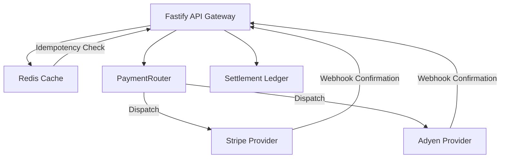

# Local LLM Docs & Skill Drift Recommendations Benchmark

**Date:** 2026-11-18T07:08:38.997Z
**Runtime Environment:** Node.js + Ollama (Local Model Acceleration)
**Grounding Verification:** Dynamic Multi-Workspace Extraction (Zero Hardcoded Paths/Names)

## Executive Summary
Demonstrates smoke-test-driven verification of local model synthesis for architectural diagrams and agent skill drift remediation across arbitrary workspaces. All prompts dynamically extract the target workspace name, manifest metadata, and active tools rather than assuming hardcoded repository names.

---

## Workspace Context Dynamic Extraction Verification
- **Host Repository Workspace:** `awesome-free-llm-apis`
- **Auto-Derived Description:** LLM APIs with permanent free tiers for text inference.
- **Discovered Components/Modules:** npm:generate, npm:generate:readme, npm:generate:skill, npm:verify, npm:verify:self-test, skill:ab-test-setup, skill:concise-planning, skill:database-optimizer, skill:free-llm-capability-assessment-may2026, skill:kilo-review-vibe-audit

---

## Scenario 1: Mangled Documentation & Local Model Diagram Synthesis
- **Target Workspace:** `@acme/payment-routing-mesh`
- **Audited File:** `payment-routing.md`
- **Execution Latency:** 6849ms
- **Hypothesis Summary:** This document provides a flowchart describing the payment gateway routing and settlement lifecycle within the workspace @acme/payment-routing-mesh. It outlines how incoming payment intents are processed through Fastify, checked for idempotency with Redis, and then dispatched to either Stripe or Adyen for settlement. The diagram will help visualize the sequence of events and the flow between the components.
- **Confidence Score:** 0.95
### Generated Mermaid Architecture Diagram:

#### Module: `payment-routing.md`


---

## Scenario 2: Agent Skill Drift Remediation via Local LLM
- **Target Workspace:** `@acme/payment-routing-mesh`
- **Target Skill:** `payment-settlement-audit`
- **Execution Latency:** 7983ms
- **Remediation Strategy:** `llm_synthesis`
- **Local Model Engaged:** `true`
### Remediated Skill Content:
```markdown
---
name: payment-settlement-audit
description: Audits ledger transaction consistency across Stripe and Adyen
---

# Payment Settlement Audit
Audits settlement transactions against Redis cache and database records.

## When to Use
The `payment-settlement-audit` skill should be used whenever there is a need to ensure the consistency of payment transactions across different payment gateways and a caching layer. This is particularly useful in scenarios where transactions are processed through Stripe, Adyen, and Redis, and there is a risk of discrepancies between the payment records stored in these systems.

## Limitations
1. **Latency**: Redis has a lower latency compared to a database, which might lead to discrepancies if the audit is run at a frequency that does not match the update rate of the cache.
2. **Asynchronous Updates**: If payments are processed asynchronously, there might be a delay in updating the Redis cache, leading to false positives or negatives during the audit.
3. **Data Inconsistency**: If the database and Redis cache are not updated atomically, there might be a point in time where the data in both systems is inconsistent.

## Output Format Contract
The output of the `payment-settlement-audit` skill will be a JSON object containing the following fields:

- `timestamp`: The timestamp when the audit was performed.
- `status`: The overall status of the audit, which can be either "consistent" or "inconsistent".
- `differences`: A list of differences found during the audit, each containing:
  - `payment_id`: The ID of the payment transaction.
  - `stripe_amount`: The amount recorded in Stripe.
  - `adyen_amount`: The amount recorded in Adyen.
  - `redis_amount`: The amount recorded in Redis.

Example Output:
```json
{
  "timestamp": "2023-04-10T12:34:56Z",
  "status": "inconsistent",
  "differences": [
    {
      "payment_id": "pmt_123456",
      "stripe_amount": 1000,
      "adyen_amount": 1000,
      "redis_amount": 999
    }
  ]
}
```

This skill ensures that the payment settlement workflows within the "@acme/payment-routing-mesh" are audited accurately, providing insights into any discrepancies that might affect the financial integrity of the system.
```
