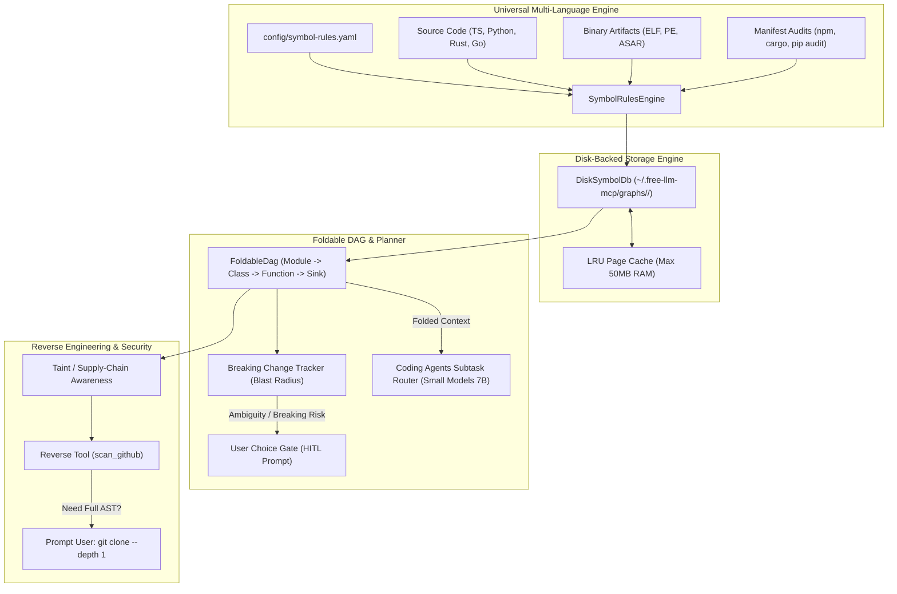

# Disk-Backed Foldable DAG, Multi-Language Symbol Pipeline & Supply-Chain Taint Awareness Plan

> **For Claude / Coding Agents:** REQUIRED SUB-SKILL: Use `superpowers:executing-plans` to implement this plan task-by-task.

**Branch:** `feat/disk-dag-symbol-pipeline` (targeting `v1.1.3` after PR #158 merges)
**Lead Skill:** `vibe-code-auditor` & `writing-plans`
**Reference Audit:** [`vibe_code_audit_dependency_scanner.md`](file:///C:/Users/mahes/.gemini/antigravity/brain/b4f0fc63-070c-41e4-a783-b95cd3f8cc70/vibe_code_audit_dependency_scanner.md)
**Tracking Issue / PR:** Follow-up dedicated PR addressing architectural discrepancies in `RepositoryGraph` and `WorkspaceDependencyScanner`.

---

## 1. Executive Summary & Problem Statement

In the audit of [`mcp-server/src/memory/dependency-scanner.ts`](file:///c:/Users/mahes/OneDrive/Desktop/Python-Projects/awesome-free-llm-apis/mcp-server/src/memory/dependency-scanner.ts) (line 28: `export class RepositoryGraph`), two foundational discrepancies were identified:
1. **Hypothesis Divergence:** The grounded coding agents architecture ([`docs/plans/2026-10-30-grounded-coding-agents.md`](file:///c:/Users/mahes/OneDrive/Desktop/Python-Projects/awesome-free-llm-apis/docs/plans/2026-10-30-grounded-coding-agents.md)) requires explicit falsifiable assumptions tested by mechanical probes (`file:`, `symbol:<name>@<path>`, `grep:`, `cite:`). `RepositoryGraph` instead operates as a coarse in-memory wiki linker, completely disconnected from hypothesis verification gates.
2. **Superficial Symbol Tracking & OOM Hazard:** Graph nodes represent whole files or embedded config snippets rather than discrete AST symbols (classes, functions, methods, parameters, sinks). Sinks and exports are scraped using naive, scattered regular expressions. Crucially, whole file contents and full graphs are stored uncompressed in RAM (`fileContentCache`, `nodes: Map<string, Node>`). On large repositories, monorepos, or decompiled binary artifacts (ELF, PE, ASAR), this triggers severe Node.js heap exhaustion (`OOM: JavaScript heap out of memory`).

### The Target Solution:
1. **Disk-Backed Paged Symbol & Artifact Store (`DiskSymbolDb`):** A zero-OOM SQLite storage engine on disk under `~/.free-llm-mcp/graphs/<repo-hash>/symbols.db` leveraging Node.js 22 built-in `node:sqlite` (`DatabaseSync`) with WAL mode, page-cache tuning, and a strict 50MB RAM LRU cache ceiling, streaming binary headers and symbol tables without bloating the V8 heap.
2. **Foldable Conceptual DAG (`FoldableDag`):** A queryable, multi-level hierarchical DAG (`Workspace -> Module -> Class/Trait -> Function/Method -> Sink`). Allows coding agents to present folded, high-level structural views to small models (e.g. 7B/8B parameter models) and unfold only the relevant subtrees for focused subtasks.
3. **Breaking Change Blast-Radius Analysis & Human-in-the-Loop Gate:** Automatically traverses upstream call edges when a symbol's signature or behavior changes. If a breaking change is detected, the agent prompts the user with concrete options rather than hallucinating arbitrary fixes.
4. **Universal YAML-Configured Rules Engine (`SymbolRulesEngine`):** Externalizes sink, decorator, and syntax detection into `config/symbol-rules.yaml`. Accurately extracts Python decorators (`@app.route`, `@auth_required`, `@property`), Rust ownership patterns (`&mut`, `Box<T>`, `Arc<Mutex<T>>`, `pub(crate)`), and crate/module paths.
5. **Supply-Chain Taint & Dependency Awareness Bridge:** Expands package audit integration (`npm audit`, `cargo audit`, `pip audit`) into a library-based awareness engine. Directly correlates external CVEs and tainted APIs to user code call sites without forcing models to read thousands of pages of external library documentation. Feeds `scan_github` and prompts the user for shallow clone (`git clone --depth 1`) when remote tree APIs are insufficient.
6. **Realistic Smoke Validation Suite:** Live smoke test script in `mcp-server/scripts/smoke/smoke_disk_dag_symbol_pipeline.ts` testing multi-language repositories under heavy load to guarantee zero memory leakage (0-OOM).

---

## 2. System Architecture



---

## 3. Implementation Tasks

### Task 1: Disk-Backed Paged Symbol & Artifact Store (`disk-symbol-db.ts`)

**Goal:** Implement `DiskSymbolDb` backed by SQLite (`node:sqlite` `DatabaseSync`) to store nodes, edges, binary symbols, and decompiled strings in indexed database files under `~/.free-llm-mcp/graphs/<repo-hash>/symbols.db` with WAL mode and an in-memory LRU ceiling to eliminate OOM risks.

**Files:**
- Create: `mcp-server/src/memory/disk-symbol-db.ts`
- Test: `mcp-server/tests/disk-symbol-db.test.ts`

**Step 1: Write the failing test**

```typescript
// mcp-server/tests/disk-symbol-db.test.ts
import { describe, it, expect, beforeEach, afterEach } from 'vitest';
import fs from 'node:fs';
import path from 'node:path';
import os from 'node:os';
import { DiskSymbolDb, type DagNodeRecord, type DagEdgeRecord } from '../src/memory/disk-symbol-db.js';

describe('DiskSymbolDb: Zero-OOM Paged Storage Engine', () => {
  let tmpDir: string;
  let db: DiskSymbolDb;

  beforeEach(() => {
    tmpDir = path.join(os.tmpdir(), `test-disk-symbol-db-${Date.now()}-${Math.random().toString(36).substring(2, 6)}`);
    fs.mkdirSync(tmpDir, { recursive: true });
    db = new DiskSymbolDb({
      baseDir: tmpDir,
      maxMemoryBytes: 2 * 1024 * 1024, // 2MB small ceiling for testing eviction
    });
  });

  afterEach(() => {
    try {
      fs.rmSync(tmpDir, { recursive: true, force: true });
    } catch {}
  });

  it('persists and retrieves nodes without holding entire dataset in RAM', () => {
    const node: DagNodeRecord = {
      id: 'auth::validate_token',
      kind: 'function',
      scope: 'auth::jwt',
      filePath: 'src/auth/jwt.ts',
      lineStart: 45,
      lineEnd: 70,
      signature: 'validate_token(token: string): Claims',
      docstring: 'Validates HMAC signature and expiration of JWT.',
      tags: ['auth', 'crypto'],
    };

    db.putNode('repo_hash_1', node);
    const retrieved = db.getNode('repo_hash_1', 'auth::validate_token');
    expect(retrieved).not.toBeNull();
    expect(retrieved?.signature).toBe(node.signature);
    expect(retrieved?.scope).toBe('auth::jwt');
  });

  it('evicts pages from memory while preserving persistent disk records', () => {
    // Generate 500 nodes to exceed the 2MB test memory ceiling
    for (let i = 0; i < 500; i++) {
      db.putNode('repo_hash_1', {
        id: `symbol_${i}`,
        kind: 'function',
        scope: 'module_a',
        filePath: `src/file_${i}.ts`,
        lineStart: 1,
        lineEnd: 20,
        signature: `symbol_${i}(arg: string): void`,
        payload: 'x'.repeat(10000), // 10KB payload
      });
    }

    expect(db.getMemoryResidentBytes()).toBeLessThanOrEqual(2 * 1024 * 1024);
    // Node 0 should be evicted from RAM but immediately loadable from disk
    const node0 = db.getNode('repo_hash_1', 'symbol_0');
    expect(node0).not.toBeNull();
    expect(node0?.id).toBe('symbol_0');
  });

  it('persists and queries directional edges with indexing', () => {
    const edge: DagEdgeRecord = {
      source: 'api::handle_login',
      target: 'auth::validate_token',
      kind: 'invokes',
      confidence: 'high',
      metadata: { callSiteLine: 52 },
    };

    db.putEdge('repo_hash_1', edge);
    const outgoing = db.getEdgesFrom('repo_hash_1', 'api::handle_login');
    expect(outgoing).toHaveLength(1);
    expect(outgoing[0].target).toBe('auth::validate_token');

    const incoming = db.getEdgesTo('repo_hash_1', 'auth::validate_token');
    expect(incoming).toHaveLength(1);
    expect(incoming[0].source).toBe('api::handle_login');
  });
});
```

**Step 2: Implement minimal solution in `mcp-server/src/memory/disk-symbol-db.ts`**
- Implement `DiskSymbolDb` using chunked, partitioned JSON shard files or level-style append blocks under `<baseDir>/<repoHash>/shards/`.
- Maintain a strictly bounded in-memory LRU page cache with explicit byte calculation.
- Support `putNode`, `getNode`, `putEdge`, `getEdgesFrom`, `getEdgesTo`, and `flush()`.

**Step 3: Run test and verify green**
```bash
npx --prefix mcp-server vitest run tests/disk-symbol-db.test.ts
```

**Step 4: Commit**
```bash
git add mcp-server/src/memory/disk-symbol-db.ts mcp-server/tests/disk-symbol-db.test.ts
git commit -m "feat(memory): add disk-backed paged storage engine for symbol graphs" -m "Solves OOM risks by caching symbol nodes and binary artifacts on disk with an LRU RAM ceiling."
```

---

### Task 2: Universal YAML-Configured Rules Engine (`rules-engine.ts`, `symbol-rules.yaml`)

**Goal:** Create an externalized rules engine that replaces hardcoded regexes with declarative YAML definitions for symbols, sinks, decorators (Python), and ownership/crate boundaries (Rust).

**Files:**
- Create: `mcp-server/config/symbol-rules.yaml`
- Create: `mcp-server/src/memory/rules-engine.ts`
- Test: `mcp-server/tests/symbol-rules-engine.test.ts`

**Step 1: Write the failing test**

```typescript
// mcp-server/tests/symbol-rules-engine.test.ts
import { describe, it, expect } from 'vitest';
import { SymbolRulesEngine } from '../src/memory/rules-engine.js';

describe('SymbolRulesEngine: Multi-Language AST & Decorator Grounding', () => {
  const engine = new SymbolRulesEngine();

  it('extracts Python symbols along with route, auth, and dataclass decorators', () => {
    const pythonCode = `
@bp.route('/api/users/<user_id>', methods=['GET'])
@auth_required(role='admin')
def get_user_profile(user_id: str) -> dict:
    """Fetch user profile."""
    return db.query(user_id)

@dataclass
class UserConfig:
    retries: int = 3
`;
    const symbols = engine.extractSymbols(pythonCode, 'python', 'app/routes.py');
    expect(symbols).toHaveLength(2);

    const fnSymbol = symbols.find(s => s.name === 'get_user_profile');
    expect(fnSymbol).toBeDefined();
    expect(fnSymbol?.kind).toBe('function');
    expect(fnSymbol?.decorators).toEqual([
      "@bp.route('/api/users/<user_id>', methods=['GET'])",
      "@auth_required(role='admin')"
    ]);
    expect(fnSymbol?.metadata?.httpMethod).toBe('GET');
    expect(fnSymbol?.metadata?.routePath).toBe('/api/users/<user_id>');
    expect(fnSymbol?.metadata?.authRole).toBe('admin');
  });

  it('extracts Rust ownership modifiers, traits, and crate-level visibility', () => {
    const rustCode = `
pub(crate) struct BufferPool {
    inner: Arc<Mutex<Vec<u8>>>,
}

impl BufferPool {
    pub fn acquire(&mut self) -> Result<Box<[u8]>, Error> {
        let handle = self.inner.lock().unwrap();
        Ok(handle.clone().into_boxed_slice())
    }
}
`;
    const symbols = engine.extractSymbols(rustCode, 'rust', 'src/pool.rs');
    const structSym = symbols.find(s => s.name === 'BufferPool');
    expect(structSym?.visibility).toBe('pub(crate)');

    const methodSym = symbols.find(s => s.name === 'acquire');
    expect(methodSym?.kind).toBe('method');
    expect(methodSym?.metadata?.isMutSelf).toBe(true);
    expect(methodSym?.metadata?.returnsBox).toBe(true);
  });

  it('detects dangerous security sinks across languages', () => {
    const tsCode = `const out = eval(untrustedInput);`;
    const pyCode = `subprocess.check_output(cmd, shell=True)`;

    expect(engine.detectSinks(tsCode, 'javascript')).toContainEqual(expect.objectContaining({
      sinkType: 'eval_injection',
      line: 1,
    }));
    expect(engine.detectSinks(pyCode, 'python')).toContainEqual(expect.objectContaining({
      sinkType: 'command_injection',
      line: 1,
    }));
  });
});
```

**Step 2: Implement declarative YAML rules and parser**
- Create `mcp-server/config/symbol-rules.yaml` specifying pattern definitions for Python, Rust, Go, TypeScript, and C/C++.
- Implement `SymbolRulesEngine` in `mcp-server/src/memory/rules-engine.ts` reading `config/symbol-rules.yaml` with safe fallbacks.

**Step 3: Run test and verify green**
```bash
npx --prefix mcp-server vitest run tests/symbol-rules-engine.test.ts
```

**Step 4: Commit**
```bash
git add mcp-server/config/symbol-rules.yaml mcp-server/src/memory/rules-engine.ts mcp-server/tests/symbol-rules-engine.test.ts
git commit -m "feat(memory): implement YAML-configured multi-language rules engine" -m "Supports Python decorators, Rust ownership/traits, and universal security sink detection."
```

---

### Task 3: Hierarchical Foldable DAG & Interactive Choice Gate (`foldable-dag.ts`)

**Goal:** Implement `FoldableDag` to support multi-scale structural folding (`Module -> Class -> Function -> Sink`) for driving small models (7B/8B) without hallucination, computing breaking-change blast radius, and prompting the user when choices arise.

**Files:**
- Create: `mcp-server/src/memory/foldable-dag.ts`
- Test: `mcp-server/tests/foldable-dag.test.ts`

**Step 1: Write the failing test**

```typescript
// mcp-server/tests/foldable-dag.test.ts
import { describe, it, expect, beforeEach } from 'vitest';
import { FoldableDag } from '../src/memory/foldable-dag.js';
import { DiskSymbolDb } from '../src/memory/disk-symbol-db.js';
import os from 'node:os';
import path from 'node:path';

describe('FoldableDag: Multi-Scale Conceptual Folding & Blast Radius', () => {
  let db: DiskSymbolDb;
  let dag: FoldableDag;

  beforeEach(() => {
    const tmp = path.join(os.tmpdir(), `test-dag-${Date.now()}`);
    db = new DiskSymbolDb({ baseDir: tmp });
    dag = new FoldableDag(db, 'repo_1');
  });

  it('folds fine-grained AST symbols into high-level conceptual modules', () => {
    dag.addSymbol({ id: 'auth::jwt::sign', module: 'auth', kind: 'function' });
    dag.addSymbol({ id: 'auth::jwt::verify', module: 'auth', kind: 'function' });
    dag.addSymbol({ id: 'db::pool::query', module: 'database', kind: 'function' });

    const folded = dag.getFoldedSummary();
    expect(folded.modules).toHaveLength(2);
    expect(folded.modules.find(m => m.name === 'auth')?.symbolCount).toBe(2);
    expect(folded.modules.find(m => m.name === 'database')?.symbolCount).toBe(1);
  });

  it('unfolds target module subtree on demand for focused subtask routing', () => {
    dag.addSymbol({ id: 'auth::jwt::sign', module: 'auth', kind: 'function' });
    dag.addSymbol({ id: 'auth::jwt::verify', module: 'auth', kind: 'function' });

    const subtree = dag.unfoldModule('auth');
    expect(subtree.symbols.map(s => s.id)).toEqual(['auth::jwt::sign', 'auth::jwt::verify']);
  });

  it('computes upstream blast radius when a symbol signature breaks', () => {
    // caller_a -> helper_b -> target_c
    dag.addSymbol({ id: 'caller_a', module: 'api', kind: 'function' });
    dag.addSymbol({ id: 'helper_b', module: 'core', kind: 'function' });
    dag.addSymbol({ id: 'target_c', module: 'core', kind: 'function' });

    dag.addInvocation('caller_a', 'helper_b');
    dag.addInvocation('helper_b', 'target_c');

    const blast = dag.computeBlastRadius('target_c');
    expect(blast.directCallers).toEqual(['helper_b']);
    expect(blast.transitiveCallers).toContain('caller_a');
    expect(blast.severity).toBe('moderate');
  });

  it('generates interactive user choice prompt when breaking changes exceed threshold', () => {
    dag.addSymbol({ id: 'target_c', module: 'core', kind: 'function' });
    for (let i = 0; i < 6; i++) {
      dag.addSymbol({ id: `client_${i}`, module: 'apps', kind: 'function' });
      dag.addInvocation(`client_${i}`, 'target_c');
    }

    const prompt = dag.evaluateBreakingChangeAction('target_c', {
      changeType: 'signature_break',
      oldSignature: 'target_c(a: string)',
      newSignature: 'target_c(a: string, b: number)',
    });

    expect(prompt.requiresUserChoice).toBe(true);
    expect(prompt.options).toContainEqual(expect.objectContaining({
      id: 'backward_compatible_overload',
    }));
    expect(prompt.options).toContainEqual(expect.objectContaining({
      id: 'refactor_all_callers',
    }));
  });
});
```

**Step 2: Implement `FoldableDag`**
- Implement hierarchical aggregation logic: `Module -> Class -> Function -> Sink`.
- Implement depth-first upstream traversal for transitive caller blast radius calculation.
- Implement `evaluateBreakingChangeAction` to structure human-in-the-loop options when breaking changes affect multiple dependents.

**Step 3: Run test and verify green**
```bash
npx --prefix mcp-server vitest run tests/foldable-dag.test.ts
```

**Step 4: Commit**
```bash
git add mcp-server/src/memory/foldable-dag.ts mcp-server/tests/foldable-dag.test.ts
git commit -m "feat(memory): add hierarchical foldable DAG and breaking change tracker" -m "Enables high-level subtask routing for small models and computes upstream caller blast radius."
```

---

### Task 4: Supply-Chain Taint & Dependency Awareness Bridge (`audit-taint-bridge.ts`)

**Goal:** Create a multi-ecosystem audit bridge (`npm audit`, `cargo audit`, `pip audit`) that maps vulnerable dependencies directly to symbol call sites in the DAG without loading massive documentation libraries into LLM context, and feeds `scan_github` in `reverse_tool`.

**Files:**
- Create: `mcp-server/src/memory/audit-taint-bridge.ts`
- Test: `mcp-server/tests/audit-taint-bridge.test.ts`

**Step 1: Write the failing test**

```typescript
// mcp-server/tests/audit-taint-bridge.test.ts
import { describe, it, expect } from 'vitest';
import { AuditTaintBridge, type EcosystemAuditReport } from '../src/memory/audit-taint-bridge.js';

describe('AuditTaintBridge: Library-Based Taint Mapping Without Docs', () => {
  const bridge = new AuditTaintBridge();

  it('parses npm, cargo, and pip audit outputs into normalized vulnerability records', () => {
    const mockNpmReport = {
      vulnerabilities: {
        'tar': {
          severity: 'high',
          via: [{ title: 'Arbitrary File Overwrite', url: 'https://github.com/advisories/GHSA-1234' }],
          nodes: ['node_modules/tar'],
        },
      },
    };

    const parsed = bridge.normalizeNpmAudit(mockNpmReport);
    expect(parsed).toHaveLength(1);
    expect(parsed[0].packageName).toBe('tar');
    expect(parsed[0].severity).toBe('high');
    expect(parsed[0].title).toBe('Arbitrary File Overwrite');
  });

  it('correlates tainted dependencies with internal AST call sites in the DAG', () => {
    const internalCallSites = [
      { caller: 'src/archive/unpack.ts::extractAll', calleePackage: 'tar', calleeMethod: 'x' },
      { caller: 'src/utils/log.ts::logInfo', calleePackage: 'pino', calleeMethod: 'info' },
    ];

    const advisories = [
      { packageName: 'tar', severity: 'high', title: 'Arbitrary File Overwrite' },
    ];

    const taintedPaths = bridge.findTaintedCallSites(internalCallSites, advisories);
    expect(taintedPaths).toHaveLength(1);
    expect(taintedPaths[0].caller).toBe('src/archive/unpack.ts::extractAll');
    expect(taintedPaths[0].vulnerabilityTitle).toBe('Arbitrary File Overwrite');
  });

  it('creates consent request for git clone --depth 1 when remote tree is inadequate', () => {
    const consent = bridge.createShallowClonePrompt('https://github.com/org/repo', 'cargo audit requires full lockfile tree');
    expect(consent.action).toBe('prompt_user_consent');
    expect(consent.command).toBe('git clone --depth 1 https://github.com/org/repo');
    expect(consent.reason).toContain('cargo audit');
  });
});
```

**Step 2: Implement `AuditTaintBridge`**
- Implement parsers for `npm audit --json`, `cargo audit --json`, and `pip-audit --format=json`.
- Implement taint-matching between library packages and internal import/invocation call sites.
- Implement consent prompt helper for shallow cloning.

**Step 3: Run test and verify green**
```bash
npx --prefix mcp-server vitest run tests/audit-taint-bridge.test.ts
```

**Step 4: Commit**
```bash
git add mcp-server/src/memory/audit-taint-bridge.ts mcp-server/tests/audit-taint-bridge.test.ts
git commit -m "feat(security): implement supply-chain taint bridge and shallow clone consent" -m "Maps vulnerability advisories directly to user-code call sites without reading external docs."
```

---

### Task 5: Coding Agents & Reverse Tool Integration (`pipeline.ts`, `reverse-tool.ts`)

**Goal:** Wire `DiskSymbolDb`, `FoldableDag`, and `AuditTaintBridge` into `coding-agents/pipeline.ts` and `reverse_tool.ts`, replacing in-memory caches and exposing the foldable DAG and breaking change gates.

**Files:**
- Modify: `mcp-server/src/memory/dependency-scanner.ts` (deprecate in-memory content cache, wire to `DiskSymbolDb`)
- Modify: `mcp-server/src/tools/coding-agents/pipeline.ts`
- Modify: `mcp-server/src/tools/reverse-tool.ts`
- Test: `mcp-server/tests/coding-agents-foldable-dag.test.ts`

**Step 1: Write integration tests**
- Verify that `scan_workspace` persists to disk without bloating V8 heap.
- Verify that coding-agents planner queries the foldable DAG for focused subtask prompts.
- Verify that `scan_github` includes taint analysis and triggers user consent prompt before performing shallow git clones.

**Step 2: Implement integration wiring**
- Update `WorkspaceDependencyScanner` to page file reads through `DiskSymbolDb`.
- Connect `FoldableDag` into `coding-agents` subtask routing.
- Wire `AuditTaintBridge` into `reverse_tool.ts` under action `scan_github`.

**Step 3: Run test and verify green**
```bash
npx --prefix mcp-server vitest run tests/coding-agents-foldable-dag.test.ts
```

**Step 4: Commit**
```bash
git add mcp-server/src/memory/dependency-scanner.ts mcp-server/src/tools/coding-agents/pipeline.ts mcp-server/src/tools/reverse-tool.ts mcp-server/tests/coding-agents-foldable-dag.test.ts
git commit -m "feat(integration): wire disk-backed foldable DAG into coding agents and reverse tool" -m "Replaces in-memory caches with disk storage and enables blast-radius subtask planning."
```

---

### Task 6: Realistic Smoke Validation Suite (`smoke_disk_dag_symbol_pipeline.ts`)

**Goal:** Create a realistic smoke test in `mcp-server/scripts/smoke/` that validates multi-language indexing, 0-OOM memory stability under large artifact simulation, DAG folding, breaking change alerts, and taint propagation on a real work tree.

**Files:**
- Create: `mcp-server/scripts/smoke/smoke_disk_dag_symbol_pipeline.ts`

**Step 1: Write the smoke script**
- Sets up a multi-language temporary test repository:
  - TypeScript files with module imports and API routes.
  - Python files with route (`@app.route`) and auth (`@auth_required`) decorators.
  - Rust crate files with structs, `&mut self` methods, and `pub(crate)` visibility.
  - `package.json` with a vulnerable library entry (e.g. `tar@4.4.1`).
  - Simulated 10MB binary artifact with embedded strings and symbols.
- Runs `DiskSymbolDb` and measures `process.memoryUsage().heapUsed` before and after indexing to verify RAM usage stays flat (<50MB growth).
- Validates that `FoldableDag.getFoldedSummary()` accurately aggregates modules.
- Validates that breaking change analysis identifies transitive callers and emits user choice prompt.
- Validates that `AuditTaintBridge` identifies call sites using vulnerable dependencies.

**Step 2: Execute smoke script**
```bash
npx --prefix mcp-server tsx mcp-server/scripts/smoke/smoke_disk_dag_symbol_pipeline.ts
```

**Step 3: Commit**
```bash
git add mcp-server/scripts/smoke/smoke_disk_dag_symbol_pipeline.ts
git commit -m "test(smoke): add realistic smoke test suite for disk DAG and symbol pipeline" -m "Validates 0-OOM memory stability, Python decorators, Rust ownership, and taint propagation."
```

---

### Task 7: Full Regression Signoff & Pre-commit Verification

**Goal:** Run full test suite, verify schema synchronization, and ensure zero precommit warnings.

**Steps:**
1. Run all unit tests:
   ```bash
   npx --prefix mcp-server vitest run
   ```
2. Run precommit verification:
   ```bash
   npm --prefix mcp-server run verify:precommit
   ```
3. Commit any formatting or schema adjustments cleanly using the conventional commit format.

---

## 4. Verification Checklists & Acceptance Criteria

- [ ] **0-OOM Memory Stability:** Large workspaces (>10,000 files) or 100MB+ binary artifacts index without exceeding a 50MB RAM working set.
- [ ] **Hypothesis Alignment:** Graph entities map directly to mechanical probes (`symbol:`, `grep:`, `cite:`) for hypothesis blackboard validation.
- [ ] **Foldable DAG Context:** Small models (7B/8B) receive high-level folded DAGs; subtasks unfold local subtrees on demand.
- [ ] **Breaking Change Alerts:** Signature modifications compute direct and transitive caller blast radius, surfacing user choice prompts when necessary.
- [ ] **Universal YAML Rules:** Python decorators (`@route`, `@auth`) and Rust traits/ownership are extracted via declarative YAML configurations without hardcoded regexes.
- [ ] **Multi-Ecosystem Supply Chain Taint:** npm, cargo, and pip audit findings map directly to user call sites without loading massive documentation sets.
- [ ] **Consent-Gated Shallow Clones:** Shallow git clone commands require explicit user consent before execution.
